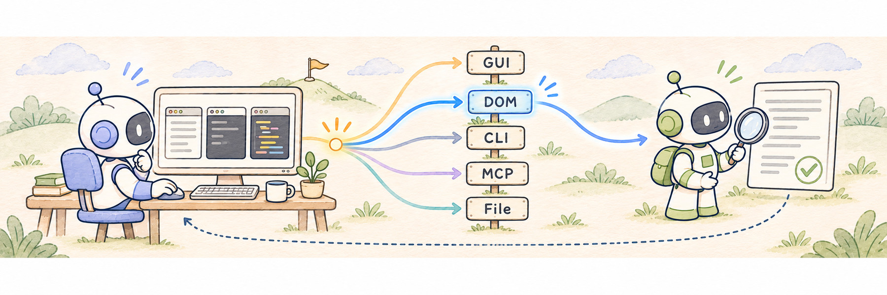
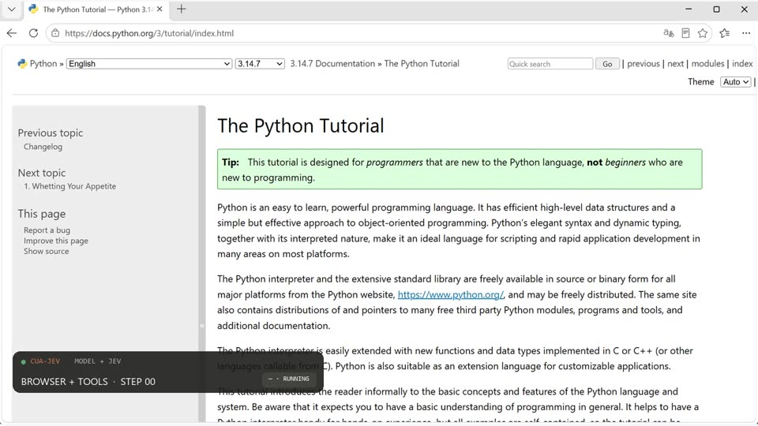
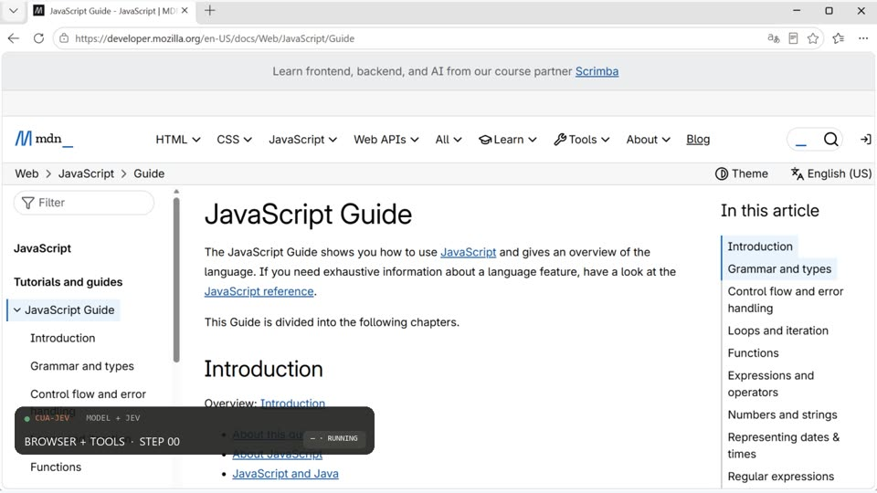
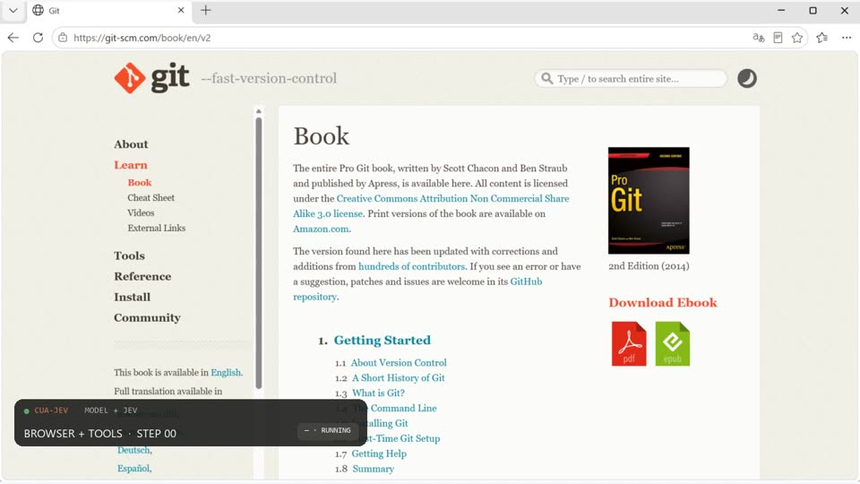
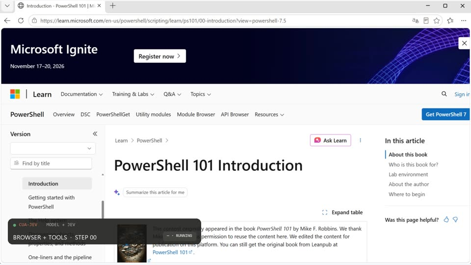

<div align="center">

<h1>
  <picture>
    <source media="(prefers-color-scheme: dark)" srcset="assets/title-dark.svg">
    
  </picture>
</h1>

### Jev for Computer Use

[Webpage](https://zjureal.com/CUA-JEV/) · [Watch demos](https://zjureal.com/CUA-JEV/#windows-cases) · [中文文档](README.zh-CN.md)

</div>

<p align="center">
  
</p>

CUA-JEV is an open-source reference framework for computer-use agents built on [Jev](https://docs.typesafe.ai/introduction). A text model proposes grounded next actions; task adapters turn them into **legal, executable, verifiable** `intent × channel` candidates (GUI, DOM, UIA, COM, CLI, MCP, file API); Jev picks **the action and the route that executes it**; a guard, an executor and an independent verifier close the loop.

> Recorded single runs, not benchmarks. Published desktop workflows are Windows-only; arbitrary-task generalization is not claimed.

## How it works

1. **Observe** — an adapter reads live state and lists only the currently legal `intent × channel` candidates.
2. **Select** — Jev's `choice` API returns one candidate ID; the action and its arguments are already typed, so Jev writes no code.
3. **Guard & execute** — `ActionGuard` checks freshness, identity, scope and permissions, then a registered executor runs the route.
4. **Verify & repeat** — an independent verifier checks the new state, a JSONL trace records the step, and the loop observes again.

Reusable pieces: [`ActionCandidate`](src/cua_jev/models.py), [`AgentRuntime`](src/cua_jev/runtime.py), [`ActionGuard`](src/cua_jev/guard.py), [`ExecutorRegistry`](src/cua_jev/registry.py).

## Recorded Windows runs

Four real model + Jev runs (18–21 actions each, zero VLM calls). Click a preview for the video and step trace.

| Python automation · 19 actions | JavaScript study guide · 18 actions |
|:---:|:---:|
| [](https://zjureal.com/CUA-JEV/#case-python-guide) | [](https://zjureal.com/CUA-JEV/#case-javascript-guide) |
| **Git workflow · 21 actions** | **PowerShell learning guide · 19 actions** |
| [](https://zjureal.com/CUA-JEV/#case-git-guide) | [](https://zjureal.com/CUA-JEV/#case-powershell-guide) |

Earlier task-specific workflows, open-task pilots and the roadmap: [docs/EXPERIMENTS.md](docs/EXPERIMENTS.md) · [open-task notes](docs/OPEN_TASKS.md).

## Quick start

Windows, Python 3.11+. The keyless Rule baseline runs first:

```powershell
py -m venv .venv
.\.venv\Scripts\Activate.ps1
python -m pip install -e ".[dev,all,ui]"
playwright install chromium
cua-jev doctor
cua-jev demo --policy rule
```

With Jev (keep the key in the Git-ignored `.env`):

```powershell
Copy-Item .env.example .env   # set TYPESAFE_API_KEY=...
cua-jev jev-smoke
cua-jev suite --task vscode --policy jev --profile adaptive --open-vscode
```

`--task edge|excel|vscode|explorer|all`; `--profile adaptive` = Hybrid, `visible` = GUI only. Local showcase: `cua-jev-ui` → http://127.0.0.1:8768.

## Extend with another task

Write an observer with a verifiable state ([`observers.py`](src/cua_jev/observers.py)), emit an [`ActionCandidate`](src/cua_jev/models.py) for every legal `intent × channel`, register executors ([`registry.py`](src/cua_jev/registry.py)), and add an independent verifier ([`verify.py`](src/cua_jev/verify.py)). Start from [`inspect_report.json`](src/cua_jev/predefined/inspect_report.json).

## Safety, license, acknowledgements

`ActionGuard` fails closed on identity, stale observations, allowed roots, writes and external side effects; CLI uses registered argv templates only, and API keys never enter traces or the repo. Code under [Apache-2.0](LICENSE). Thanks to [TypeSafe AI](https://typesafe.ai/) for Jev and to [RoboJEV](https://github.com/lykycy123/RoboJEV) for inspiration; CUA-JEV is an independent project, not an official TypeSafe AI product.
