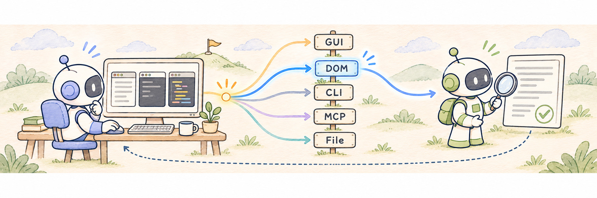
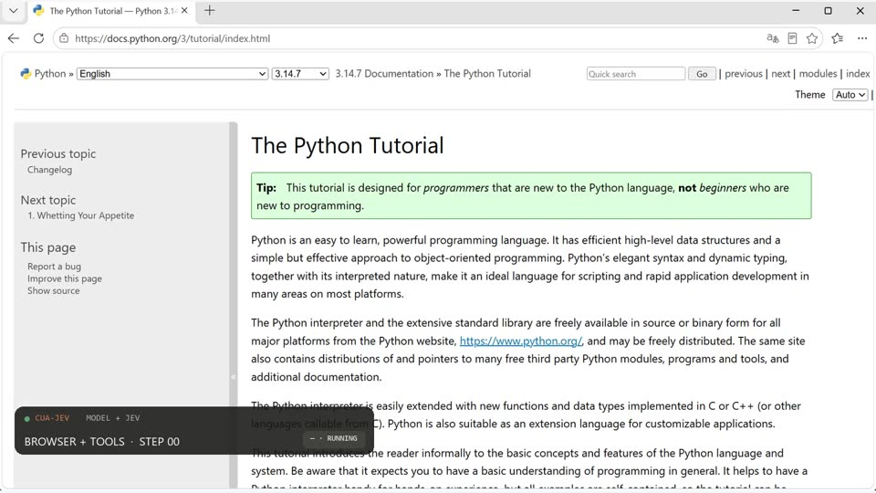
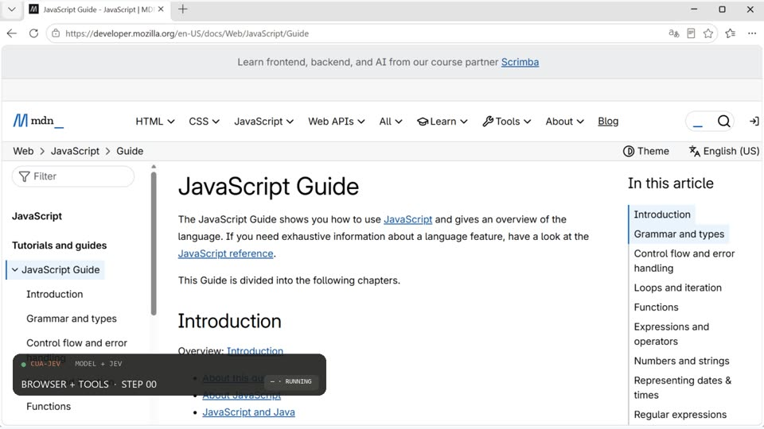
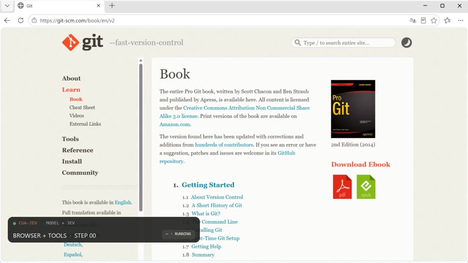
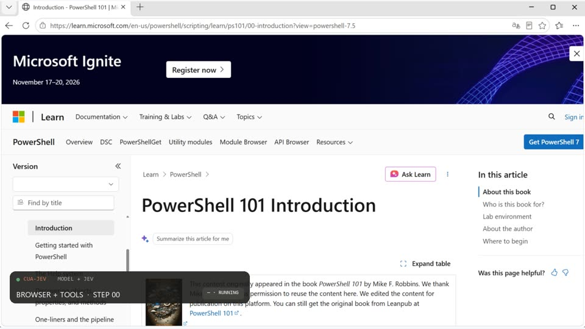

<div align="center">

<h1>
  <picture>
    <source media="(prefers-color-scheme: dark)" srcset="assets/title-dark.svg">
    
  </picture>
</h1>

### Jev for Computer Use

[项目网页](https://zjureal.com/CUA-JEV/) · [观看 Demo](https://zjureal.com/CUA-JEV/#windows-cases) · [English README](README.md)

</div>

<p align="center">
  
</p>

CUA-JEV 是基于 [Jev](https://docs.typesafe.ai/introduction) 的 Computer-Use Agent 开源参考框架。文本模型提出有依据的下一步；任务适配器把它展开为**当前合法、可执行、可验证**的 `意图 × 通道` 候选（GUI、DOM、UIA、COM、CLI、MCP、文件 API）；Jev 选出**具体动作及其执行路线**；Guard、执行器与独立验证器闭合循环。

> 案例为单次录制，不是基准评测；已发布的桌面工作流仅支持 Windows，不声称任意任务泛化。

## 核心机制

1. **观察**：适配器读取实时状态，只列出此刻合法的 `意图 × 通道` 候选。
2. **选择**：Jev 的 `choice` 接口返回一个候选 ID；动作与参数已类型化，Jev 不生成代码。
3. **检查与执行**：`ActionGuard` 检查新鲜度、身份、范围与权限，再交给注册的执行器。
4. **验证与循环**：独立验证器检查新状态，JSONL trace 记录该步，然后重新观察。

可复用组件：[`ActionCandidate`](src/cua_jev/models.py)、[`AgentRuntime`](src/cua_jev/runtime.py)、[`ActionGuard`](src/cua_jev/guard.py)、[`ExecutorRegistry`](src/cua_jev/registry.py)。

## Windows 录制案例

四次真实的模型 + Jev 运行（每次 18–21 个动作，VLM 调用为零）。点击预览查看视频与逐步记录。

| Python 自动化指南 · 19 个动作 | JavaScript 学习指南 · 18 个动作 |
|:---:|:---:|
| [](https://zjureal.com/CUA-JEV/#case-python-guide) | [](https://zjureal.com/CUA-JEV/#case-javascript-guide) |
| **Git 工作流 · 21 个动作** | **PowerShell 学习指南 · 19 个动作** |
| [](https://zjureal.com/CUA-JEV/#case-git-guide) | [](https://zjureal.com/CUA-JEV/#case-powershell-guide) |

早期任务专属工作流、开放任务实验与 Roadmap：[docs/EXPERIMENTS.zh-CN.md](docs/EXPERIMENTS.zh-CN.md) · [开放任务说明](docs/OPEN_TASKS.md)。

## 快速开始

需要 Windows 与 Python 3.11+。先运行无需密钥的 Rule 基线：

```powershell
py -m venv .venv
.\.venv\Scripts\Activate.ps1
python -m pip install -e ".[dev,all,ui]"
playwright install chromium
cua-jev doctor
cua-jev demo --policy rule
```

使用 Jev（密钥只放在被 Git 忽略的 `.env`）：

```powershell
Copy-Item .env.example .env   # 设置 TYPESAFE_API_KEY=...
cua-jev jev-smoke
cua-jev suite --task vscode --policy jev --profile adaptive --open-vscode
```

`--task edge|excel|vscode|explorer|all`；`--profile adaptive` 为 Hybrid，`visible` 为 GUI Only。本地展示页：`cua-jev-ui` → http://127.0.0.1:8768。

## 扩展一个新任务

实现输出可验证状态的观察器（[`observers.py`](src/cua_jev/observers.py)），为每个合法的 `意图 × 通道` 构建 [`ActionCandidate`](src/cua_jev/models.py)，注册执行器（[`registry.py`](src/cua_jev/registry.py)），并添加独立验证器（[`verify.py`](src/cua_jev/verify.py)）。可从 [`inspect_report.json`](src/cua_jev/predefined/inspect_report.json) 入手。

## 安全、许可与致谢

`ActionGuard` 对候选身份、过期观察、允许目录、写入和外部副作用执行 fail-closed 检查；CLI 只用注册的 argv 模板，API 密钥不进入 trace 或仓库。代码以 [Apache-2.0](LICENSE) 发布。感谢 [TypeSafe AI](https://typesafe.ai/) 提供 Jev，感谢 [RoboJEV](https://github.com/lykycy123/RoboJEV) 的启发；CUA-JEV 是独立项目，并非 TypeSafe AI 官方产品。
